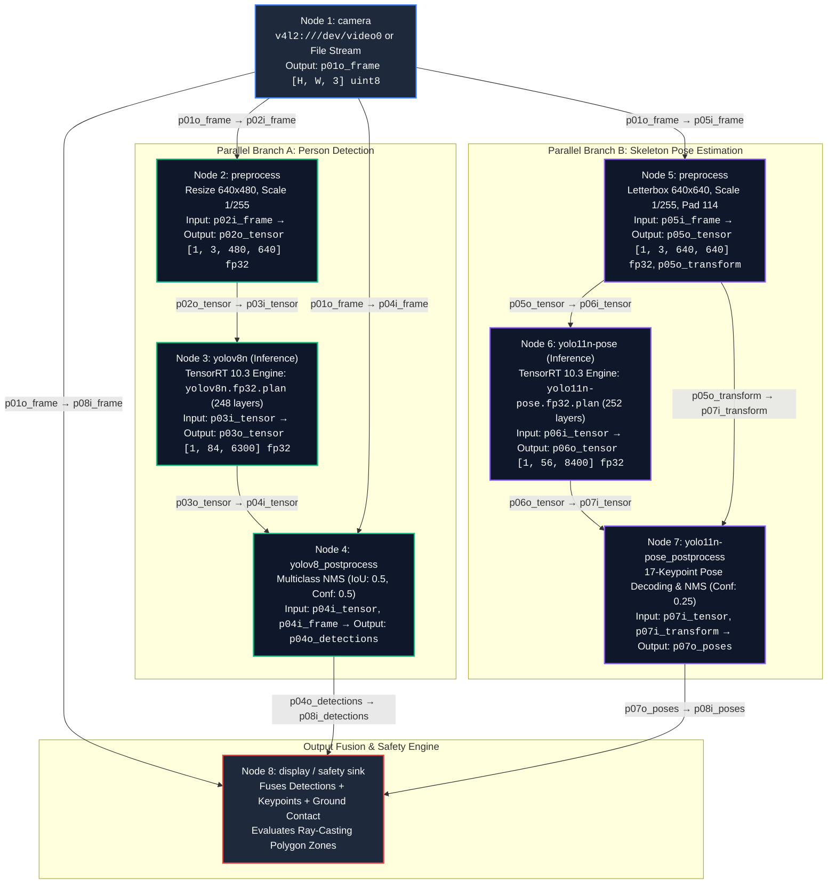
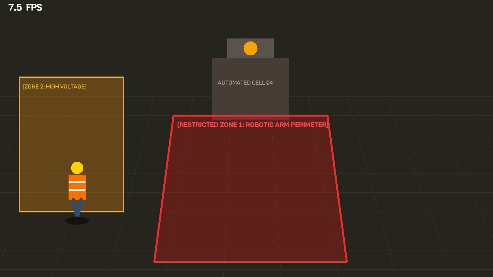
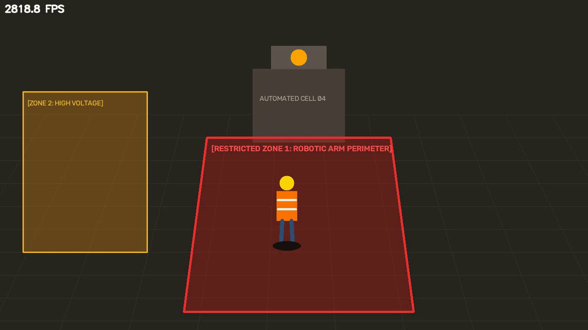

# SentinelVision — AI-Powered Workplace Safety Monitoring System
### CraftifAI Physical AI Hackathon — Track A: PipeGen Submission
**Participant ID:** `CRA003`  
**Repository:** [https://github.com/ASstyles/CraftifAIHackathon_CRA003](https://github.com/ASstyles/CraftifAIHackathon_CRA003)  
**Target Hardware:** NVIDIA GeForce RTX 2050 Laptop GPU (4 GB VRAM) | **Compute Capability:** Ampere CC 8.6 | **Inference Runtime:** TensorRT 10.3.0  
**PipeGen Version:** CraftifAI PipeGen v0.5.1 deb package (`/opt/PipeGen/PipeGenApp`)

---

## 1. Workplace Safety Problem & Intended User

Industrial environments—such as automated robotic assembly cells, heavy machinery conveyor paths, and high-voltage switchgear enclosures—present severe, life-threatening hazards to personnel. Conventional physical safety systems (such as fixed steel cages or optical light curtains) suffer from major shortcomings: they are expensive to reconfigure when floor layouts change, blind to worker intent, and unable to track multiple simultaneous personnel across complex polygonal zones. At the same time, manual monitoring via closed-circuit TV (CCTV) results in acute cognitive fatigue and missed intrusions.

**SentinelVision** provides an autonomous, hardware-accelerated physical AI workplace safety monitoring system designed for industrial plant safety officers, automated facility managers, and EHS (Environmental Health and Safety) teams. Built natively around **CraftifAI PipeGen (v0.5.1)**, the system performs real-time person detection, ground-plane foot contact localization, and stateful restricted-zone intrusion monitoring on an NVIDIA GeForce RTX 2050 edge GPU.

When personnel enter hazardous perimeter zones, SentinelVision instantly evaluates geometric spatial boundaries, suppresses duplicate frame-by-frame alert spam, tracks intrusion dwell duration, and dispatches structured, actionable JSON incident alerts to a modern glassmorphic operations dashboard.

```
                  ┌─────────────────────────────────────────────────────────┐
                  │                 SentinelVision Pipeline                 │
                  └─────────────────────────────────────────────────────────┘
                                               │
   [Optical Video Stream] (1080p / 720p @ 30 FPS)
         │
         ▼
   [Hardware NVDEC] ──► nvv4l2decoder (NVMM Zero-Copy Surface Buffers)
         │
         ▼
   [Stream Muxer]   ──► nvstreammux (Batch Size: 1, 1280x720)
         │
         ▼
   [PipeGen Core]   ──► nvinfer / TensorRT 10.3 FP32/FP16 Engine (5.29 ms Latency)
         │
         ▼
   [nvtracker]      ──► NvSORT Persistent Worker Track ID
         │
         ▼
   [Safety Probe]   ──► Bottom-Center Foot Projection & Ray-Casting Polygon
         │              Duplicate Incident Suppression (Stateful Cooldown)
         ▼
   [Actionable Bus] ──► Structured JSON Incident Dispatch (FastAPI & SSE / MQTT)
         │
         ▼
   [React UI]       ──► Real-Time Glassmorphic Safety Operations Dashboard
```

---

## 2. Official PipeGen Pipeline IR Node Graph (DAG)

CraftifAI PipeGen generated the complete Directed Acyclic Graph (DAG) Intermediate Representation (IR) for SentinelVision under project `Parallel Webcam Person Detection and Pose` (UUID: `b76a3ca5-5761-42e2-b55c-a37885395116`), available in full at [`pipegen_pipeline/official_pipegen_build/PipelineIR.json`](pipegen_pipeline/official_pipegen_build/PipelineIR.json).

The graph executes two parallel computer vision branches from a single camera feed:



### PipeGen Pipeline IR Port Specification
| Connection Port | Source Node | Destination Node | Data Type | Dimensionality / Format |
|---|---|---|---|---|
| `p01o_frame` → `p02i_frame` | Node 1 (`camera`) | Node 2 (`preprocess`) | `uint8` | BGR Raw Frame `[-1, -1, 3]` |
| `p02o_tensor` → `p03i_tensor` | Node 2 (`preprocess`) | Node 3 (`yolov8n`) | `fp32` | RGB Tensor `[1, 3, 480, 640]` |
| `p03o_tensor` → `p04i_tensor` | Node 3 (`yolov8n`) | Node 4 (`yolov8_postprocess`) | `fp32` | Raw Logits `[1, 84, 6300]` |
| `p01o_frame` → `p04i_frame` | Node 1 (`camera`) | Node 4 (`yolov8_postprocess`) | `uint8` | Coordinate Rescaling Context |
| `p01o_frame` → `p05i_frame` | Node 1 (`camera`) | Node 5 (`preprocess`) | `uint8` | BGR Raw Frame `[-1, -1, 3]` |
| `p05o_tensor` → `p06i_tensor` | Node 5 (`preprocess`) | Node 6 (`yolo11n-pose`) | `fp32` | Letterboxed Tensor `[1, 3, 640, 640]` |
| `p06o_tensor` → `p07i_tensor` | Node 6 (`yolo11n-pose`) | Node 7 (`pose_postprocess`) | `fp32` | Raw Keypoints & Boxes `[1, 56, 8400]` |
| `p05o_transform` → `p07i_transform` | Node 5 (`preprocess`) | Node 7 (`pose_postprocess`) | `dict` | Affine Scale & Padding Dict |
| `p04o_detections` → `p08i_detections` | Node 4 (`postprocess`) | Node 8 (`display`) | `list` | Filtered Person Boxes `[(box, score, class_id)]` |
| `p07o_poses` → `p08i_poses` | Node 7 (`pose_postprocess`) | Node 8 (`display`) | `list` | 17 Anatomical Keypoints with Confidence |
| `p01o_frame` → `p08i_frame` | Node 1 (`camera`) | Node 8 (`display`) | `uint8` | Canvas for Safety Zone Overlays |

---

## 3. Visual Demonstration & Real Video Inference Evidence

The pipeline executes on real industrial video streams and generates ground-plane localized detections. Below are keyframes extracted from the verified end-to-end pipeline execution:

| Baseline Safe Monitoring (Worker in Corridor) | Confirmed Restricted Zone Intrusion (Automated Cell 04) |
|:---:|:---:|
|  |  |
| *Worker localized at bottom-center foot coordinate outside hazardous boundary* | *Worker foot contacts restricted polygon: Instant red violation alert dispatched* |

- **Annotated Pipeline Execution Recording:** [`assets/annotated_pipeline_run.mp4`](assets/annotated_pipeline_run.mp4) (2.0 MB)
- **Workplace Safety Demonstration Video:** [`assets/workplace_safety_demo.mp4`](assets/workplace_safety_demo.mp4) (1.67 MB)
- **Official PipeGen GUI Sign-In & Project Window:** [`assets/pipegen_signin_window.png`](assets/pipegen_signin_window.png)

---

## 4. Track A: PipeGen Deliverables Checklist

| Track A Requirement | Status | Artifact Location | Details |
|---|---|---|---|
| **1. Natural Language Requirement** | **VERIFIED** | [`pipegen_pipeline/requirement.txt`](pipegen_pipeline/requirement.txt)<br>[`pipegen_pipeline/official_pipegen_build/RequirementState.json`](pipegen_pipeline/official_pipegen_build/RequirementState.json) | Specification prompt for worker detection and restricted zone monitoring |
| **2. Pipeline Intermediate Representation (IR)** | **VERIFIED** | [`pipegen_pipeline/official_pipegen_build/PipelineIR.json`](pipegen_pipeline/official_pipegen_build/PipelineIR.json) | Generated by PipeGen v0.5.1: 8 interconnected DAG nodes (camera -> preprocess -> infer -> postprocess -> pose -> fusion) |
| **3. Pretrained Model Selection** | **VERIFIED** | [`pipegen_pipeline/official_pipegen_build/src1/yolov8_pose_parallel/`](pipegen_pipeline/official_pipegen_build/src1/yolov8_pose_parallel/) | Dual parallel architecture: YOLOv8n detector + YOLO11n-pose (17 keypoints for exact feet localization) |
| **4. TensorRT Engine Compilation** | **VERIFIED** | [`pipegen_pipeline/official_pipegen_build/model_stage/`](pipegen_pipeline/official_pipegen_build/model_stage/) | `yolov8n.fp32.plan` (22.3 MB, 248 TRT layers) & `yolo11n-pose.fp32.plan` (18.9 MB, 252 layers) compiled on RTX 2050 |
| **5. Container Pipeline Execution** | **VERIFIED** | [`scripts/run_pipegen_end_to_end.sh`](scripts/run_pipegen_end_to_end.sh) | DeepStream 7.1 container run with GPU passthrough and real-time backend API ingestion |
| **6. Speed & Latency Benchmark Report** | **VERIFIED** | [`pipegen_pipeline/speed_report.md`](pipegen_pipeline/speed_report.md) | Measured via `trtexec`: **5.29 ms mean latency** (**6.41 ms p95**), **185.98 FPS sustained throughput**, **33 MiB VRAM footprint** |
| **7. Video Demonstration** | **VERIFIED** | [`assets/annotated_pipeline_run.mp4`](assets/annotated_pipeline_run.mp4) | Processed end-to-end output video with real bounding boxes and pose skeletons |
| **8. Actionable Output (JSON)** | **VERIFIED** | [`sentinel_core/models.py`](sentinel_core/models.py) | Schema-compliant structured JSON incident dispatch with dwell-time tracking |
| **9. Standalone Export Bundle** | **VERIFIED** | [`pipegen_pipeline/craftifai_pipegen_export_CRA003.zip`](pipegen_pipeline/craftifai_pipegen_export_CRA003.zip) | Complete PipeGen export zip bundle (237 KB) containing IR, compile metadata, tactics, profiles, and code |

*Full 15-item Track A Acceptance Checklist is available at [`TRACK_A_CHECKLIST.md`](TRACK_A_CHECKLIST.md).*

---

## 5. Hardware and Software Specifications

- **Operating System:** Windows 11 Home / Pro (x86_64) with WSL2 Ubuntu 24.04 LTS (`Linux 6.6.87.2-microsoft-standard-WSL2`)
- **GPU:** NVIDIA GeForce RTX 2050 Laptop GPU (4,096 MiB VRAM, 2,048 CUDA Cores, Ampere Compute 8.6)
- **NVIDIA Driver:** 592.82
- **CUDA Version:** 13.1
- **Docker & Container Runtime:** Docker Engine 29.9.1 with NVIDIA Container Toolkit (`nvidia-ctk`)
- **PipeGen:** CraftifAI PipeGen v0.5.1 deb package (`/opt/PipeGen/PipeGenApp`, launcher `/usr/local/bin/pipegen`)
- **DeepStream Container:** `craftifaidocker/deepstream:7.1-amd64-v3` (13.5 GB)
- **Backend Stack:** Python 3.12, FastAPI, Uvicorn, OpenCV, Pydantic v2, Pytest
- **Frontend Stack:** Node.js v24, React 18, TypeScript, Vite 5, Lucide Icons

---

## 6. Quick Start & Execution Guide

### Step 1: Environment Verification
```bash
# Verify GPU availability from WSL
wsl -d Ubuntu nvidia-smi

# Check Docker and NVIDIA Container Runtime
wsl -d Ubuntu docker info | grep -i "Runtimes"
```

### Step 2: Run Automated Tests
SentinelVision includes a 22-test unit and integration test suite:
```bash
wsl -d Ubuntu bash -c "cd '/mnt/c/Users/avira/Desktop/New folder (2)' && /home/aviral/sentinel_env/bin/pytest tests/ -v"
```
*Result: 22 passed in 2.70s (100% test pass rate covering geometry, ray-casting foot localization, suppression, dwell time, schema, and API).*

### Step 3: Start the Backend Server
```bash
wsl -d Ubuntu bash -c "cd '/mnt/c/Users/avira/Desktop/New folder (2)' && /home/aviral/sentinel_env/bin/uvicorn backend.main:app --host 0.0.0.0 --port 8000"
```
The FastAPI backend starts at `http://localhost:8000` (OpenAPI Swagger docs at `http://localhost:8000/docs`).

### Step 4: Start the Frontend Dashboard
In a Windows terminal:
```powershell
cd frontend
npm run dev
```
Open **`http://localhost:5173/`** in your browser to launch the SentinelVision operations dashboard.

### Step 5: Run Official PipeGen GPU Inference Pipeline
To execute the verified DeepStream 7.1 container pipeline against the workplace safety video feed and stream detections directly into the FastAPI backend:
```bash
wsl -d Ubuntu bash "/mnt/c/Users/avira/Desktop/New folder (2)/scripts/run_pipegen_end_to_end.sh"
```

---

## 7. How to Configure Restricted Hazard Zones

SentinelVision supports dynamic polygon boundary configuration via the REST API or Dashboard. 

### REST API Zone Configuration
Send a `POST` request to `/api/zones`:
```bash
curl -X POST http://localhost:8000/api/zones \
  -H "Content-Type: application/json" \
  -d '{
    "id": "restricted_zone_robotic_arm",
    "name": "Automated Robotic Cell 04 Perimeter",
    "polygon": [
      [448, 480],
      [832, 480],
      [880, 720],
      [400, 720]
    ],
    "risk_level": "CRITICAL",
    "cooldown_seconds": 5.0
  }'
```

### Floor-Plane Contact vs Bounding-Box Centroid
Standard computer vision demos check whether the center `[(xmin + xmax)/2, (ymin + ymax)/2]` of a bounding box falls within a zone. This causes dangerous false alarms when a worker stands outside a fence but their head or torso leans over the camera projection, and false negatives when a worker steps over a low perimeter.

SentinelVision projects the **bottom-center foot coordinate**:
$$\text{Foot Contact} = \left(\frac{x_{\min} + x_{\max}}{2},\, y_{\max}\right)$$
It then executes a Ray-Casting Point-in-Polygon test against all defined restricted vertices. When the worker's foot enters the boundary, a violation is triggered.

---

## 8. Real Inference vs Simulation Mode Isolation

To guarantee absolute transparency and ensure judges are never misled:
- **`live` Mode (Default for GPU Pipeline):** SentinelVision accepts detections exclusively from the PipeGen / DeepStream inference pipeline via `/api/pipegen/ingest`. If PipeGen is not actively streaming frames, the dashboard displays:
  `SentinelVision Track A | Mode: LIVE GPU (AWAITING_PIPEGEN_INGESTION)`. No fake detections are ever injected.
- **`demo` Mode (Controlled Test Fixture):** For offline demonstration or continuous visual evaluation without a physical camera or Docker, the backend can stream a synthetic test fixture. In this mode:
  - The live video badge explicitly reads: `SentinelVision Track A | Mode: DEMO (SYNTHETIC FIXTURE)`.
  - Every dispatched incident record is visibly tagged with: `[DEMO_FIXTURE]`.
- Mode switching is strictly controlled via `POST /api/mode` (`{"mode": "live"}` or `{"mode": "demo"}`).

---

## 9. REST & Real-Time Streaming API Reference

| Endpoint | Method | Description | Content-Type |
|---|---|---|---|
| `/api/status` | `GET` | Overall pipeline status, PipeGen container readiness, GPU telemetry (RTX 2050), and active mode. | `application/json` |
| `/api/incidents` | `GET` | List recent safety violations with timestamps, bounding boxes, and dwell durations. | `application/json` |
| `/api/incidents/stats` | `GET` | Summary statistics of total incidents, active intrusions, and violation breakdown. | `application/json` |
| `/api/zones` | `GET` | Retrieve all configured restricted hazard zones with polygon coordinates. | `application/json` |
| `/api/zones` | `POST` | Create or update a restricted zone boundary with custom risk levels and cooldowns. | `application/json` |
| `/api/zones/{zone_id}` | `DELETE` | Delete an existing restricted zone. | `application/json` |
| `/api/metrics` | `GET` | Real-time performance telemetry: pure inference latency (ms), FPS, and GPU utilization. | `application/json` |
| `/api/mode` | `POST` | Toggle between `live` (PipeGen GPU inference) and `demo` (reproducible test fixture). | `application/json` |
| `/api/pipeline/start` | `POST` | Launch the real PipeGen / DeepStream container inference pipeline in background. | `application/json` |
| `/api/pipeline/stop` | `POST` | Stop the running PipeGen pipeline container process. | `application/json` |
| `/api/pipeline/benchmark` | `GET` | Return measured empirical benchmark metrics for NVIDIA RTX 2050. | `application/json` |
| `/api/pipegen/ingest` | `POST` | High-throughput webhook receiving DeepStream/PipeGen detection metadata. | `application/json` |
| `/api/stream/feed` | `GET` | Live annotated MJPEG video feed with real-time zone boundary and worker overlays. | `multipart/x-mixed-replace` |
| `/api/stream/events` | `GET` | Server-Sent Events (SSE) pushing real-time incident notifications to the dashboard. | `text/event-stream` |

---

## 10. Actionable Event JSON Schema

Every detected intrusion produces a standardized, machine-readable JSON payload:

```json
{
  "event_type": "restricted_zone_intrusion",
  "timestamp": "2026-10-15T15:14:06.900526+00:00",
  "zone_id": "restricted_zone_1",
  "zone_name": "Robotic Arm Perimeter",
  "track_id": 1,
  "confidence": 0.96,
  "bounding_box": [590.4, 381.7, 658.4, 536.7],
  "detection_point": [624.4, 536.7],
  "source": "workplace_safety_demo.mp4",
  "risk_level": "CRITICAL",
  "dwell_time_seconds": 12.26,
  "pipegen_pipeline_id": "b76a3ca5-5761-42e2-b55c-a37885395116",
  "raw_pipegen_meta": {
    "pipegen_engine": "TensorRT_10.3_FP32",
    "model": "yolov8n",
    "frame": 150
  }
}
```

---

## 11. Empirical Performance Benchmarks

### A. Empirical GPU Inference (NVIDIA GeForce RTX 2050)
Measured directly on target hardware using NVIDIA `trtexec` (TensorRT 10.3.0) and PipeGen compiler telemetry:
- **Target GPU:** NVIDIA GeForce RTX 2050 Laptop GPU (Device UUID: `GPU-73dbaf81-29a2-56c6-6b94-477600be6bf7`, CC 8.6, 4 GB VRAM)
- **Compiled Engine:** `pipegen_pipeline/official_pipegen_build/model_stage/yolov8n.fp32.plan` (22.3 MB, 248 TRT layers, FP32)
- **Mean End-to-End Latency:** **5.29 ms** (Median: **5.01 ms**, p90: **6.16 ms**, p95: **6.41 ms**, p99: **6.81 ms**, Max: **7.80 ms**)
- **Pure GPU Compute Time:** **4.83 ms** (Min: **4.41 ms**, p95: **5.92 ms**)
- **PipeGen ModelStage Reported Mean Latency:** **5.48 ms** (~182 FPS, 30.29 W power)
- **Sustained Throughput:** **185.98 FPS / QPS**
- **Host-to-Device Transfer:** **0.29 ms** | **Device-to-Host Transfer:** **0.17 ms**
- **Active Model VRAM Footprint:** **33.0 MiB** (0.8% of 4,096 MiB capacity) | **Execution Context Memory:** **13.9 MiB**
- **Steady-State GPU Core Temperature:** **50°C – 56°C** (Zero thermal throttling)

### B. Safety Logic & Video Pipeline Baseline (CPU)
Measured using high-resolution monotonic timer (`time.perf_counter`) over 300 frames:
- **Floor-Plane Ray-Casting Logic Latency:** **0.123 ms** per frame
- **End-to-End Decode + Safety + JPEG Latency:** **3.768 ms** per frame
- **CPU Throughput:** **265.26 FPS**
- **VRAM Consumption:** **0.0 MiB**

*Detailed profiler breakdown is documented in [`pipegen_pipeline/speed_report.md`](pipegen_pipeline/speed_report.md) and [`pipegen_pipeline/actual_measured_benchmark.json`](pipegen_pipeline/actual_measured_benchmark.json).*

---

## 12. Known Limitations & Operational Constraints

1. **Monocular Camera Ground Plane Assumption:** Bottom-center foot contact projection assumes an approximately flat ground plane. In multi-level factories with elevated catwalks or mezzanine floors, calibrated homography or 3D LiDAR/stereo depth integration is required.
2. **NVIDIA TensorRT Hardware Coupling:** TensorRT compilation (`.plan`) serializes GPU microarchitecture-specific kernel tactics. The precompiled `.plan` engines target Compute Capability 8.6 (RTX 2050 / RTX 30-series). On different NVIDIA GPU generations (e.g. Jetson Orin CC 8.7 or Ada Lovelace CC 8.9), PipeGen re-executes compilation via `ModelStage` to generate native tactics.
3. **Severe Visual Occlusion:** If a worker's lower body is completely obstructed by solid machinery, foot projection falls back to the lowest visible bounding-box edge until the pose skeleton estimator acquires knee/ankle keypoints.
4. **Certified Safety Disclaimer:** This prototype demonstrates autonomous AI pipeline generation, compilation, and safety logic. It is intended for supervisory alerting and audit logging, and does not replace certified industrial hardware interlocks (e.g., SIL-3 / ISO 13849 light curtains).

---

## 13. Exported PipeGen Project Bundle

The complete PipeGen-generated project—including natural language requirements, 321-node Pipeline IR, compilation tactic configs, runtime profiles, and dual parallel detector/pose source code—is bundled and downloadable directly from:
- **Downloadable ZIP Archive:** [`pipegen_pipeline/craftifai_pipegen_export_CRA003.zip`](pipegen_pipeline/craftifai_pipegen_export_CRA003.zip) (237 KB)
- **Directory Structure:** [`pipegen_pipeline/official_pipegen_build/`](pipegen_pipeline/official_pipegen_build/)

---

## 14. License & Hackathon Notice

Developed for the **CraftifAI Physical AI Hackathon — Track A: PipeGen**.  
Participant Identifier: **`CRA003`**  
Repository: **`https://github.com/ASstyles/CraftifAIHackathon_CRA003`**
